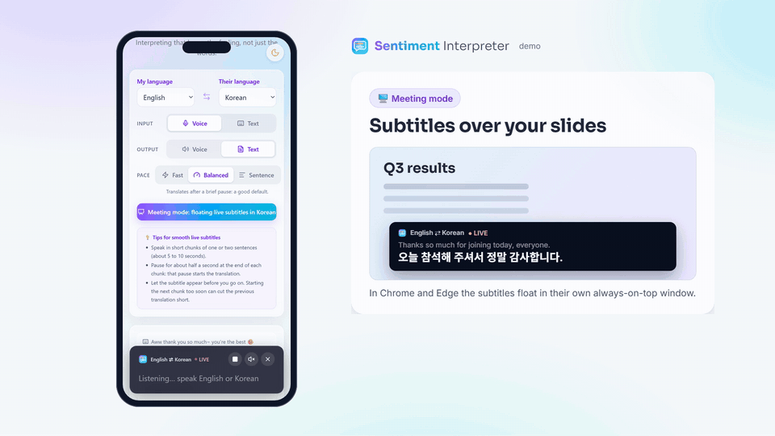
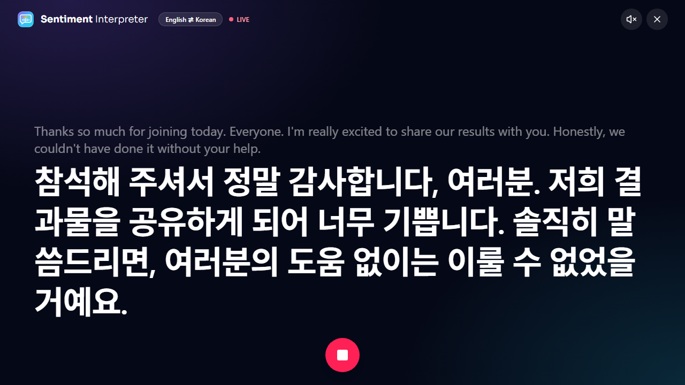

# Sentiment Interpreter

Live interpreting that keeps the feeling, not just the words. Speak or type in one language, and hear or read it in another. The voice and wording match the original's sentiment, formality and friendliness.

A sibling of [Sentiment Translator](https://github.com/bakeyeon/sentiment_translator). It uses the same SFF (Sentiment-Formality-Friendliness) rubric, here to guide a live interpreter instead of a scorer. For the SFF concept, see [The Grue Divide: When Cognitive Accuracy Doesn't Predict Affective Alignment](https://aclanthology.org/2026.pandora-1.2/) (PANDORA @ EMNLP 2026).

## Demo

▶️ Click the GIF or [watch the full demo on YouTube (1:38)](https://youtu.be/HIIB_evJC6Y), with sound: typed English spoken back in warm Korean, German *doch mal* kept casual, and live meeting subtitles. You hear the real speakers and the interpreter's own voice.

🎬 The demo video was made with [Claude Code](https://claude.com/claude-code), without a designer or video editor: the scripts in [`demo/`](demo/) record the app at phone size, replay real Gemini Live responses, and compose the cards, narration and audio. The method is described in Sentiment Translator's [guide to making a research demo video](https://github.com/bakeyeon/sentiment_translator/blob/main/docs/demo-video.md).

## Features
- **Voice or text, in and out:** pick the input (🎙️ voice or ⌨️ text) and the output (🔊 voice or 📝 text) separately. All four combinations work, and every exchange is kept in a conversation log, original above and translation below.
- **Meeting mode:** live subtitles that float in their own always-on-top window, over your slides or video call. Speak English and your audience reads Korean (or any language pair), with the spoken translation optional. The newest words always stay in view. This uses Document Picture-in-Picture (Chrome and Edge); other browsers get a translucent subtitle bar inside the page.
- **Pace:** Fast, Balanced or Sentence sets how long a pause must be (0.25 s, 0.5 s or 1 s) before the interpreter translates. Faster pace means quicker subtitles. The Live API works in turns, so speak in short chunks and let each subtitle appear before you go on; the app shows these tips under the meeting-mode button.
- **Feeling-aware interpreting:** the interpreter judges the original against SFF anchor sentences, then matches the same levels in word choice and in its voice. For example, warm and close becomes a smile in the voice, and formal becomes calm and measured. Softening particles (Thai นะ, Japanese ね, German *doch / mal*) and, in typed input, emoji, `~` and `!` are treated as feeling cues and carried over.
- **Light and dark mode,** with the same glass look as Sentiment Translator.

| Typed | Translated (Korean) |
|---|---|
| Aww thank you so much~ you're the best 😊 | 어머, 정말 감사해요~ 최고예요 😊 |
| Could you please send me the report by Friday? | 금요일까지 보고서를 보내주실 수 있을까요? |
| *(spoken German)* Komm doch mal vorbei, ich freu mich! | 놀러 와! 보고 싶어! |

## How it works
The browser connects to the server over a WebSocket (`/live`). The server opens one session with the **Gemini Live API** (`gemini-3.1-flash-live-preview`), which turns speech straight into speech: it hears the tone of the original instead of only a transcript. Typed text goes into the same session. The server also asks for transcripts of both sides, which feed the conversation log and the meeting subtitles. The SFF rubric and the voice directions are in the system instruction in [`server.ts`](server.ts).

## Run locally
**Prerequisites:** Node.js

1. Install dependencies: `npm install`
2. Put your Gemini API key in `.env.local`: `GEMINI_API_KEY=...`
3. Run the app: `npm run dev`, then open http://localhost:3000. Set `PORT` to use another port, and `GEMINI_LIVE_MODEL` to try another Live model.

## Checks without a microphone
- `node scripts/smoke-text.mjs 3000 English Korean "Thanks so much!"`: sends typed sentences and prints the translation and audio length.
- `node scripts/smoke-voice.mjs 3000 English Korean speech.pcm`: streams 16 kHz mono PCM as if from a microphone.
- `node scripts/smoke-meeting.mjs http://localhost:3000/ speech.wav out`: runs meeting mode in Chromium with a fake microphone and saves screenshots (needs `npm i -D playwright`).
- `node scripts/smoke-popout.mjs http://localhost:3000/ speech.wav popout.png`: the same, popped out into the floating window.

Originally built in [Google AI Studio](https://ai.studio/apps/bc9aa9d9-4543-413a-87a6-34bfb57e6663); redesigned with Claude Code.
